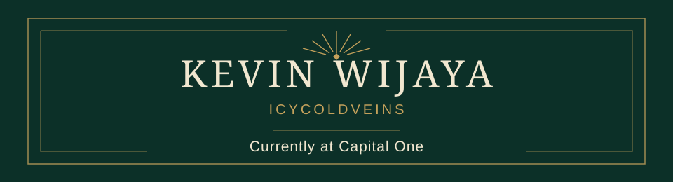
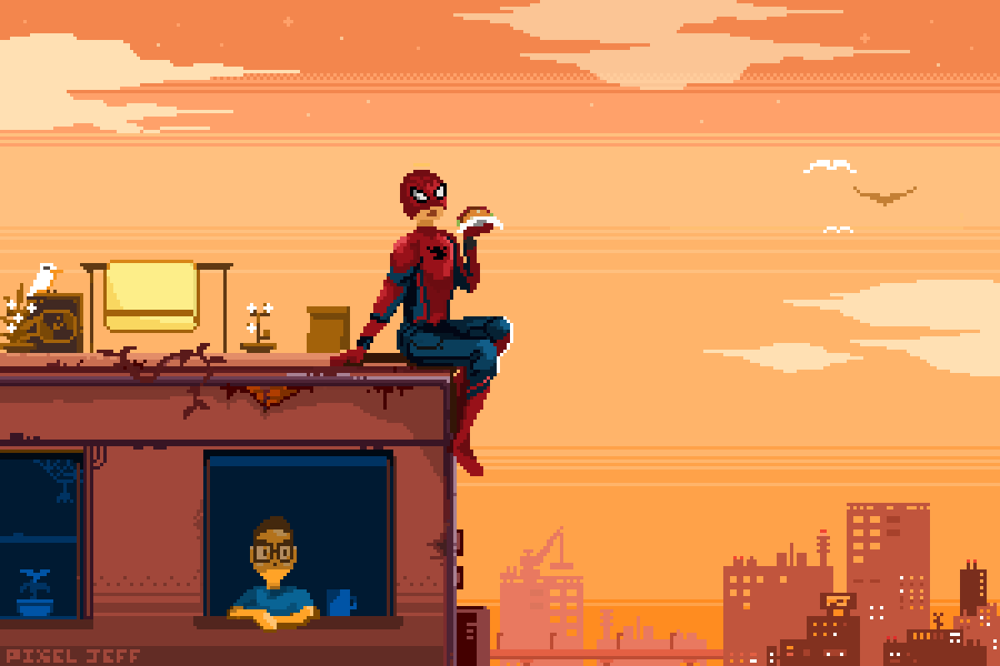

  

  

  

  <strong>Currently at Capital One</strong> 
   
  Temple University · B.S. Computer Science · Class of 2024 · Philadelphia, PA

  

**Programming and markup languages**

  
  
  
  
  
  
  
  
  
  

  
Frameworks, platforms, databases, and other tools

  

    
    
    
    
    
    
    
    
    
    
    
    
    
    
    
    
    
    
    
    
    
    
  

  

  

  

  
  
  

